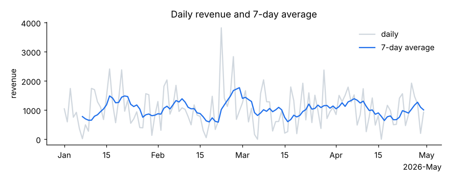
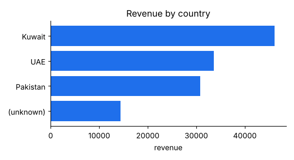
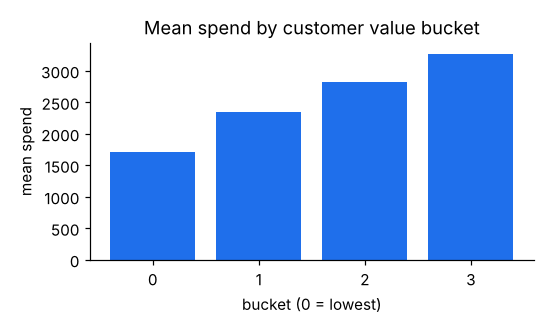

# Orders pipeline report

Synthetic data, seed 42. Customer features are measured as of 2026-04-05.

## Data quality

| Check | Count |
|---|---|
| Rows in | 507 |
| Rows out | 500 |
| Exact duplicates removed | 7 |
| Amounts missing after parsing (kept as missing, not zero) | 6 |
| Dates that could not be parsed | 0 |
| Quantities imputed with the median (flagged) | 8 |
| Orders with no country | 59 |

## Revenue by country

| country | orders | priced_orders | revenue | avg_order_value |
|---|---|---|---|---|
| Kuwait | 198 | 195 | 46,160.25 | 236.72 |
| UAE | 125 | 124 | 33,577.01 | 270.78 |
| Pakistan | 118 | 117 | 30,797.60 | 263.23 |
| (unknown) | 59 | 58 | 14,425.22 | 248.71 |

## Revenue by customer segment

| segment | orders | priced_orders | revenue | avg_order_value |
|---|---|---|---|---|
| retail | 175 | 172 | 42,968.99 | 249.82 |
| enterprise | 163 | 160 | 41,869.36 | 261.68 |
| wholesale | 162 | 162 | 40,121.73 | 247.67 |

