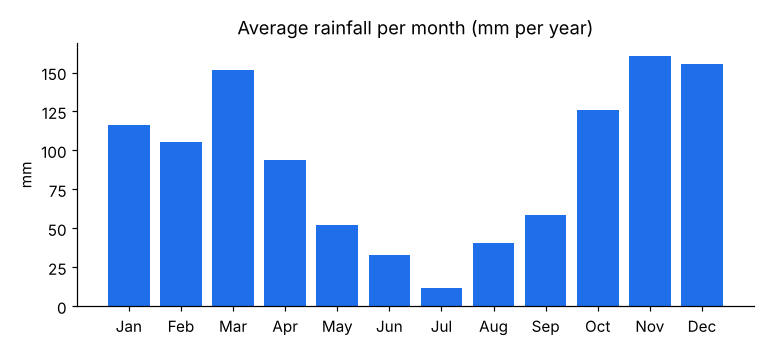
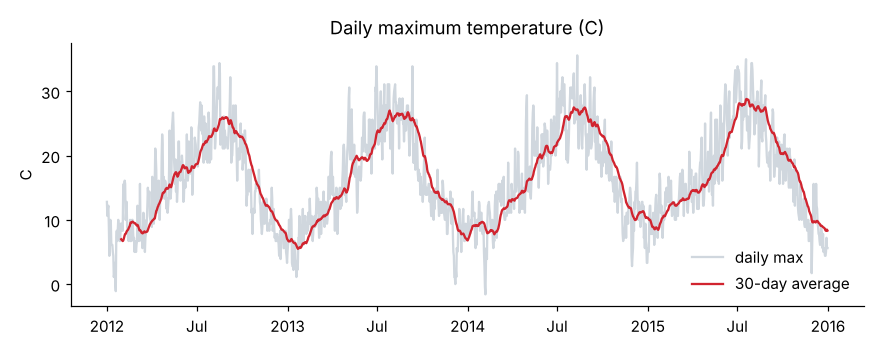
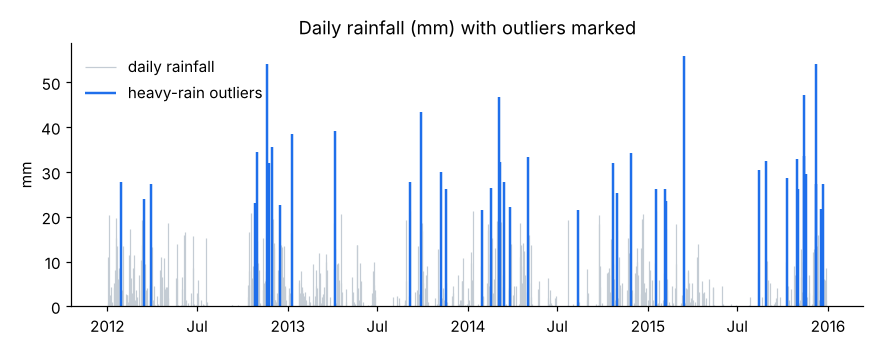

# Seattle weather, 2012-2015

1,461 daily observations from NOAA via the vega-datasets project. No missing values; temperature
ordering and duplicate dates were validated on load.

## Findings

- November is the wettest month (161 mm per year on average) and July the driest (12 mm).
- It rains on 59% of days in November versus 9% in July.
- The driest year was 2013 (828 mm) and the wettest 2014 (1233 mm).
- Mean daily maximum temperature rose from 15.3 C in 2012 to 17.4 C in 2015. Four years cannot show a climate trend, so this is year-to-year variation, not evidence of warming.
- 43 days are heavy-rain outliers (above the IQR fence among rainy days); the most extreme was 55.9 mm on 2015-03-15.
- The longest dry spell was 48 days, ending 2012-09-08.
- The longest run of days at or above 30 C was 6 days, ending 2015-07-05.

